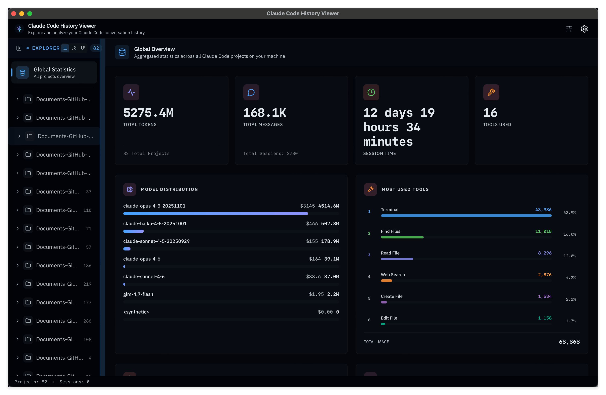

```
   (\ (\
   ( -.-)o
   o_(")(")
```

I have versatile Engineering background in AI / Data Architect, Data Engineering, Data Analytics, Software Development, DevOps engineering, Database Management, and Machine Learning, actively contributing to Python Open source community.

Popular open source project:

<!-- BEGIN pypi-downloads -->
- [uszipcode](https://github.com/MacHu-GWU/uszipcode-project): [](https://pypistats.org/packages/uszipcode)
- [pathlib_mate](https://github.com/MacHu-GWU/pathlib_mate-project): [](https://pypistats.org/packages/pathlib-mate)
- [sqlalchemy_mate](https://github.com/MacHu-GWU/sqlalchemy_mate-project): [](https://pypistats.org/packages/sqlalchemy-mate)
- [s3pathlib](https://github.com/MacHu-GWU/s3pathlib-project): [](https://pypistats.org/packages/s3pathlib)
- [boto_session_manager](https://github.com/MacHu-GWU/boto_session_manager-project): [](https://pypistats.org/packages/boto-session-manager)
- [iterproxy](https://github.com/MacHu-GWU/iterproxy-project): [](https://pypistats.org/packages/iterproxy)
- [func_args](https://github.com/MacHu-GWU/func_args-project): [](https://pypistats.org/packages/func-args)
<!-- END pypi-downloads -->

<!--
- [cottonformation](https://pypi.org/project/cottonformation/): 
- [attrs_mate](https://pypi.org/project/attrs-mate/): 
- [loggerFactory](https://pypi.org/project/loggerFactory/): 
- [superjson](https://pypi.org/project/superjson/): 
- [docfly](https://pypi.org/project/docfly/): 
- [rstobj](https://pypi.org/project/rstobj/): 
- [aws_cloudformation](https://pypi.org/project/aws_cloudformation/): 
- [aws_codebuild](https://pypi.org/project/aws_codebuild/): 
- [aws_codecommit](https://pypi.org/project/rstobj/): 
- [aws_stepfunction](https://pypi.org/project/aws_stepfunction/): 
- [aws_lambda_event](https://pypi.org/project/aws_lambda_event/): 
- [aws_arns](https://pypi.org/project/aws-arns/): 
- [aws_console_url](https://pypi.org/project/aws_console_url/): 
- [afwf](https://pypi.org/project/afwf/): 
- [pyproject_ops](https://pypi.org/project/pyproject-ops/): 
- [aws_ci_bot](https://github.com/MacHu-GWU/aws_ci_bot-project)
-->

Claude Code Power User


