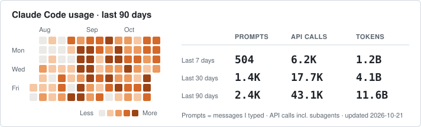

```
   (\ (\
   ( -.-)o
   o_(")(")
```

I have versatile Engineering background in AI / Data Architect, Data Engineering, Data Analytics, Software Development, DevOps engineering, Database Management, and Machine Learning, actively contributing to Python Open source community.

Popular open source project:

<!-- BEGIN pypi-downloads -->
- [uszipcode](https://github.com/MacHu-GWU/uszipcode-project): [](https://pypistats.org/packages/uszipcode)
- [pathlib_mate](https://github.com/MacHu-GWU/pathlib_mate-project): [](https://pypistats.org/packages/pathlib-mate)
- [sqlalchemy_mate](https://github.com/MacHu-GWU/sqlalchemy_mate-project): [](https://pypistats.org/packages/sqlalchemy-mate)
- [s3pathlib](https://github.com/MacHu-GWU/s3pathlib-project): [](https://pypistats.org/packages/s3pathlib)
- [boto_session_manager](https://github.com/MacHu-GWU/boto_session_manager-project): [](https://pypistats.org/packages/boto-session-manager)
- [iterproxy](https://github.com/MacHu-GWU/iterproxy-project): [](https://pypistats.org/packages/iterproxy)
- [func_args](https://github.com/MacHu-GWU/func_args-project): [](https://pypistats.org/packages/func-args)
<!-- END pypi-downloads -->

Claude Code Power User


